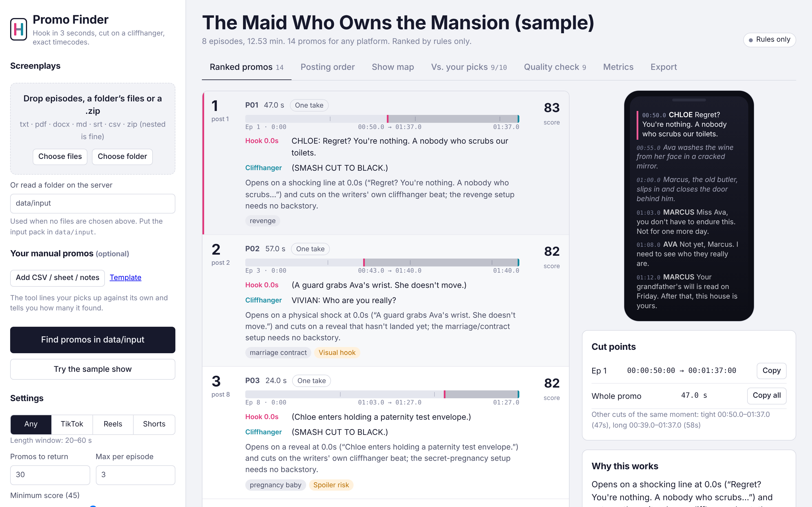
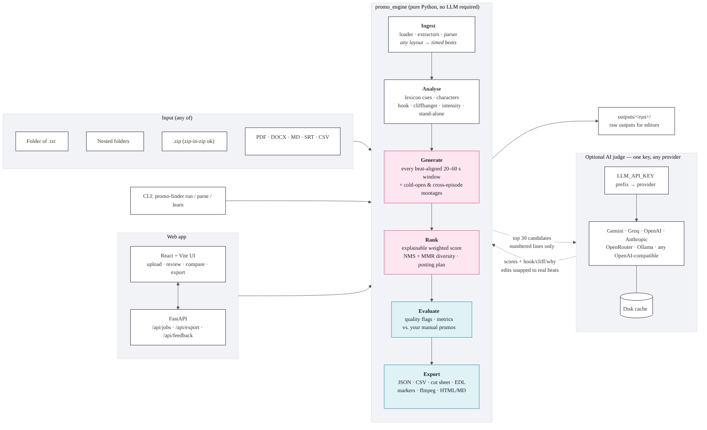
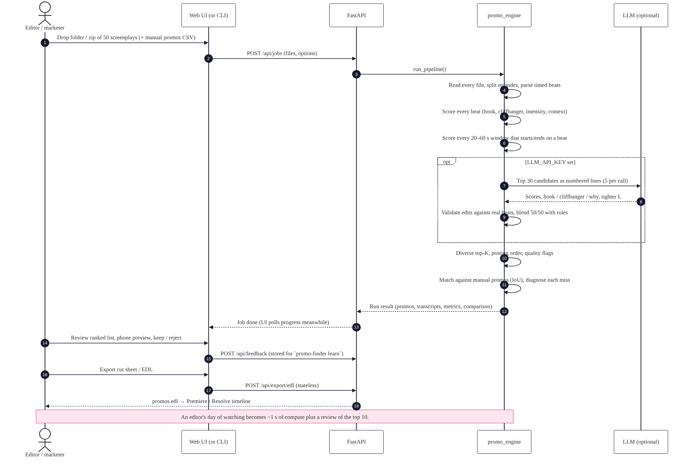
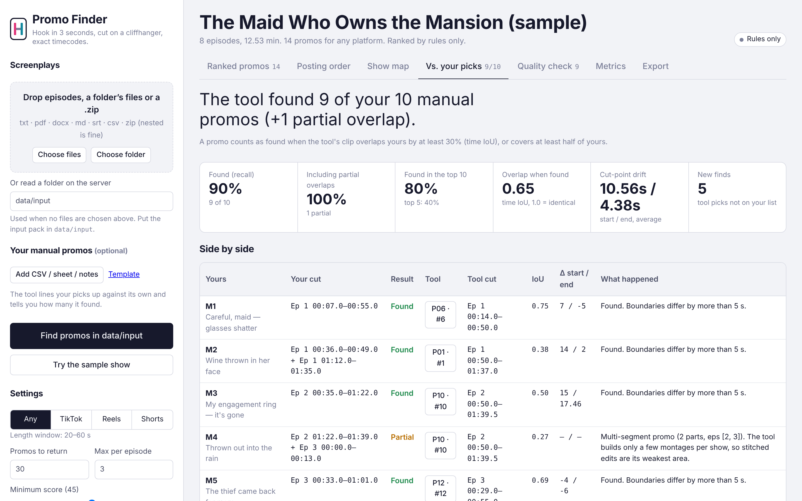

# Kuku Promo Finder

**Problem 1 of the Kuku AI Generalist assignment: find the promos.**
The tool reads a microdrama's screenplays (every scene, line and action has a timestamp) and returns ranked 20–60 second promos. Each promo **opens on a hook in the first 3 seconds**, **cuts on a cliffhanger** and **makes sense to someone who has never seen the show**. For every promo it gives the episode, start and end timestamps per segment, the hook, the cliffhanger, one line on why it works, and its place in the posting order. Editors get the cuts as a cut sheet, an EDL or markers that drop straight into Premiere or Resolve.

It runs **without any API key** (transparent rules) and gets better with **any one LLM key**. The provider is detected from the key, so switching models means pasting a different key.



---

## Quick start (5 minutes)

```bash
pip install -r requirements-dev.txt              # Python 3.10+
python -m promo_engine run -i data/sample/sample_show.zip -m data/sample/manual_promos_sample.csv
# → prints the top promos and writes outputs/run_<time>/ (cut sheet, EDL, report.html, …)

# the real input pack:
#   put it in data/input/ (folder, sub-folders, PDFs, zips — anything)
python -m promo_engine run -i data/input -m data/manual_promos/my_manual_promos.csv
```

Web app: `cd frontend && npm ci && npm run build && cd .. && python -m uvicorn backend.app:app` then open <http://localhost:8000>, or run `docker compose up --build`.
The full, ordered steps (including Vercel) are in **[RUNBOOK.md](RUNBOOK.md)**.

---

## What it does, step by step



| Stage | What happens | Done by |
|---|---|---|
| **1. Ingest** | Walks a folder, nested folders or zips (zip-in-zip, `__MACOSX` junk ignored). Reads txt/md/pdf/docx/srt/vtt/csv/json and splits files that hold several episodes. | Code |
| **2. Parse** | Understands six screenplay layouts (`[00:00:07] NAME: line`, pipe tables with ranges, classic NAME-on-its-own-line, SMPTE, SRT…). Every beat gets a start and end in seconds; missing times are interpolated and flagged. | Code |
| **3. Beat signals** | Each line is scored for hook strength (slap, reveal, shocking line…), cliffhanger strength (cut-off line, unanswered question, arrival, threat…), resolution, intensity, context-dependence and tropes. Cue lexicons live in `config/lexicons.yaml`. | Rules |
| **4. Candidates** | Every window of 20–60 s that starts and ends on a whole beat (no mid-line cuts). Also cold-open montages and cross-episode supercuts. | Code |
| **5. Score** | An explainable weighted score: hook, cliffhanger, stand-alone, intensity, pace, length fit, trope, episode end, minus a spoiler penalty. Every promo shows its breakdown. | Rules |
| **6. AI judge (optional)** | The top 30 go to an LLM in batches of 5 as **numbered lines**. It scores them like an editor and writes the hook, cliffhanger and why. Any cut-point changes are snapped back to real beats, so it can't invent a timestamp. Final score = ½ rules + ½ LLM. | LLM |
| **7. Select & order** | Overlap removal, max 3 per episode, MMR for variety, then a posting plan (spoiler-safe and strongest hooks first, tropes alternated). | Code |
| **8. Check** | Per-promo warning flags ("where it picks badly"), run metrics, and a side-by-side comparison with your manual promos that explains each miss. | Code |
| **9. Export** | Cut sheet (SMPTE, handles), CMX3600 EDL, markers, ffmpeg preview script, JSON, CSV, Markdown and a shareable HTML report. | Code |

How the score is built: **[docs/scoring.md](docs/scoring.md)** · request flow: **[docs/workflow.md](docs/workflow.md)** · components: **[docs/architecture.md](docs/architecture.md)**.



---

## Features

**Must have.** Folder / nested folder / zip / PDF / DOCX / TXT input, a parser that tolerates format differences, beat-aligned 20–60 s windows, hook-in-3-s detection, cliffhanger detection, a stand-alone check, segments + hook + cliffhanger + why for every promo, ranking with reasons, a quality report, JSON/CSV/Markdown exports, CLI and web app, and a model-agnostic LLM layer with a rules-only fallback.

**Good to have.** Multi-segment promos, platform presets (TikTok / Reels / Shorts), editor handles (pre/post-roll), YAML-tunable weights and lexicons, an LLM response cache, a character registry, overlap removal and live progress.

**What sets it apart.** **Side-by-side comparison with your manual promos** (recall, IoU, start/end error, a diagnosis per miss, new finds), an EDL and cut sheet and markers and ffmpeg script, a score breakdown per promo, microdrama trope tags, diversity-aware ranking and a posting plan.

**Cherry on top.** A show-wide drama-intensity heatmap, a 9:16 phone preview of every clip, tight/standard/long cut variants, a one-file HTML report, and editor keep/reject feedback.

**Highly advanced.** A hybrid rules→LLM pipeline with guarded boundary edits, **weights learned from your picks** (`promo-finder learn`, logistic regression), a cross-episode montage builder, a spoiler budget, an evaluation harness with ablations, and a cost and scale model.

---

## One key, any LLM

```bash
# .env — put any ONE of these in LLM_API_KEY; nothing else changes
LLM_API_KEY=AQ....         # Google Gemini (free tier; older keys start AIza...)
LLM_API_KEY=gsk_...        # Groq (free tier)
LLM_API_KEY=sk-ant-...     # Anthropic
LLM_API_KEY=sk-or-...      # OpenRouter (free models)
LLM_API_KEY=sk-...         # OpenAI
LLM_API_KEY=ollama         # local Ollama, no key
```

The prefix selects the provider and endpoint. The model is **discovered from the provider's own model list** (a cheap, fast tier is preferred), so a retired model name never breaks a run. If you need to, `LLM_MODEL`, `LLM_PROVIDER` or `LLM_BASE_URL` override this, and the last one works with any OpenAI-compatible gateway, including one that Kuku provides. Check a key with `python -m promo_engine llm-check`.
**Fallbacks:** list backup keys (`LLM_API_KEY=key1,key2` or `LLM_FALLBACK_API_KEYS=…`) and the next provider takes over if one fails. After 2 consecutive failures a circuit breaker stops calling, and a time budget (45 s on Vercel) caps the LLM step. In every case the rules ranking is kept and the run finishes.

---

## Compare with your manual promos

Put your picks in `data/manual_promos/my_manual_promos.csv` ([template](data/manual_promos/manual_promos_TEMPLATE.csv), or free text like `Ep 3 00:41-01:15`) and add `-m` to the run.
The report and the **Vs. your picks** tab show:

- **"The tool found N of your M manual promos"**, with Recall@5 and Recall@10
- each of your promos next to the tool's best match: IoU, start/end difference in seconds, and whether the hook agrees
- for every miss, *why*: too long, stitched, or out-ranked, plus the tool's score for your window and its weakest signal
- the tool's **new finds** that are not on your list



---

## Results

From **[METRICS.md](METRICS.md)**, which is regenerated by `python scripts/generate_metrics.py --input data/input`:

| | Real input pack (*I Married a Broken Soldier. He was a Duke*) | Synthetic sample show |
|---|---|---|
| Episodes / beats parsed | **50 / 3,727, 100% timed, 0 warnings** | 8 / 211, 100% timed |
| Promos | 30 (from ~865 scored candidates), median 34 s | 14 |
| Length / hook ≤ 3 s / cliffhanger / stands alone | 100% / 100% / 100% / 100% | 100% / 100% / 93% / 100% |
| Variety | 10 episodes in the top 10 | 7 episodes in the top 10 |
| Runtime, rules only | ~4 s for 50 episodes (~103 min of screen time) | 0.3 s |
| Agreement with manual picks | *add your picks with `--manual`* | 10 of 10 found, 9 in the top 10 |
| Tests | **126 passed** (incl. 3 that run only on the real pack) | |

> Brief-compliance numbers measure the picks against the tool's own thresholds, so they show the promos are well-formed, not that they are the *best* ones. That judgement needs your manual picks: add them and re-run to get recall and cut-point error. The sample's manual promos were picked by the same person who wrote the rules, so its agreement numbers are only a smoke test.

**Input layouts handled** (no configuration needed): the real pack's block layout (`**NAME (manner):**` / `Start: (mm:ss.ff) | End: (mm:ss.ff)` / text, with `CAMERA`, `ACTION`, `SOUND FX` and overlapping shots, plus a metadata header), bracketed `[00:00:07] NAME: line`, pipe/tab tables, classic screenplay layout, SRT/VTT, CSV/XLSX/JSON beats, multi-episode PDFs, DOCX/ODT/HTML, and wrong or missing extensions. When a layout is unrecognisable, a structure-agnostic fallback reader takes over. See **[docs/robustness.md](docs/robustness.md)** for every failure point and its fallback.

**Where it picks badly** (also listed in every report): visual-only beats and sarcasm (the rules read words, not shots or tone), callbacks to earlier episodes, rhetorical questions that look like cliffhangers, stitched multi-moment edits, and cut points that start 5–15 s later than an editor would because the tool trims to the hook line. The long variant keeps the set-up.

---

## Repository

```
promo_engine/      core: ingest/ analysis/ generate/ rank/ llm/ evaluate/ export/ + pipeline.py, cli.py
backend/           FastAPI (jobs, stateless exports, feedback, sandboxed server-folder input)
api/index.py       Vercel serverless entry
frontend/          React + Vite + TypeScript UI
config/            default.yaml (every weight and threshold), lexicons.yaml (cue words)
data/              input/ (the input pack goes here, git-ignored) · manual_promos/ · sample/ · feedback/
outputs/           raw outputs (sample runs included; run_full_pack.sh adds the real pack)
scripts/           make_sample_data · generate_metrics · build_solution_doc · render_diagrams · run_full_pack
docs/              architecture, workflow, scoring, scaling & cost, AI usage, video script, solution doc (MD + PDF), graphics
tests/             126 tests: unit, API, end-to-end, layout mutations, failure injection, real-pack (when present)
```

## Documents

| Doc | For |
|---|---|
| [USER_MANUAL.md](USER_MANUAL.md) | Editors and marketers using the app |
| [RUNBOOK.md](RUNBOOK.md) | Running, testing, deploying (Vercel/Docker) in order, and demo day |
| [ASSUMPTIONS.md](ASSUMPTIONS.md) | Every assumption made where the brief was silent |
| [docs/robustness.md](docs/robustness.md) | Input-structure proofing, every single point of failure and its fallback |
| [METRICS.md](METRICS.md) | Test results and the metrics that matter, with targets |
| [docs/Solution_Doc.pdf](docs/Solution_Doc.pdf) | The 2-page solution doc for the submission form |
| [docs/scaling_and_cost.md](docs/scaling_and_cost.md) | Running it on every show, every week |
| [docs/ai_usage.md](docs/ai_usage.md) | Which AI tools were used and where they got it wrong |
| [docs/walkthrough_script.md](docs/walkthrough_script.md) | 3-minute video script |

## Submission checklist (from the brief)

- [x] Solution doc, PDF, ≤ 2 pages: `docs/Solution_Doc.pdf` (rebuild with `python scripts/build_solution_doc.py` after the real run)
- [x] Prototype: this repo + Vercel deploy (`RUNBOOK.md` §5)
- [x] Raw outputs on the **full input pack**: `outputs/raw_outputs_full_pack/` (re-run `bash scripts/run_full_pack.sh` after adding your manual promos or an LLM key)
- [ ] Walkthrough video (optional): script in `docs/walkthrough_script.md`
