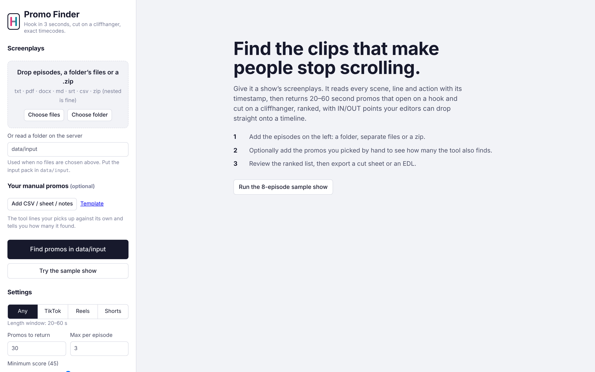
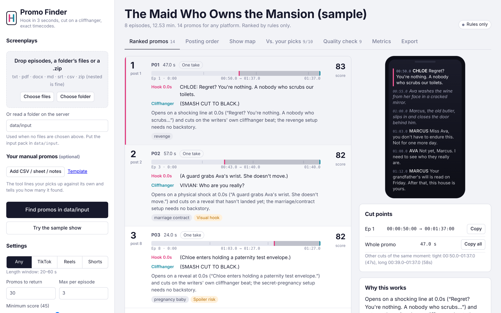
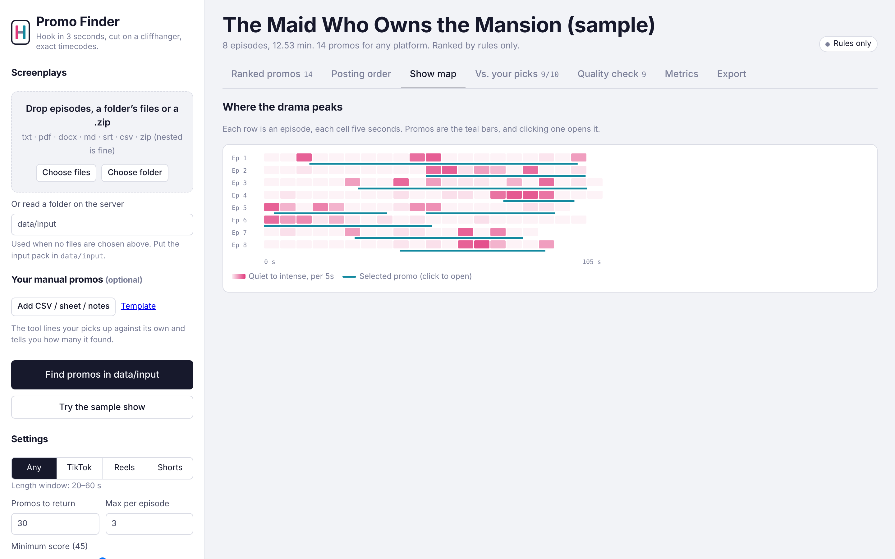

# User manual: Promo Finder

*For editors, social media and marketing teams. You don't need to know any code.*

Promo Finder reads a show's screenplays and suggests **promos**: 20–60 second clips for Instagram, TikTok and YouTube that **open on a hook** (something in the first 3 seconds that stops a scrolling thumb), **end on a cliffhanger**, and **make sense to someone who has never seen the show**. It gives you exact IN and OUT points so you can cut them without scrubbing through every episode.

It suggests and you decide. Think of it as a first pass that saves you from watching every episode, not as the final edit.

---

## 1. Open the app

Use the link your team shared (for example `https://<your-app>.vercel.app`) or, on your own computer, <http://localhost:8000>.

The left column is where you set things up. The large area on the right shows results.

## 2. Add the screenplays

You can add them in any of these ways:

- **Drag and drop** episode files onto the dashed box.
- Click **Choose files** and select them (you can select many at once).
- Click **Choose folder** and select the show's folder. Sub-folders are included.
- Add a **.zip** of the folder. A zip inside a zip is fine.

Supported files: `.txt`, `.pdf`, `.docx`, `.odt`, `.html`, `.md`, `.fountain`, `.rtf`, `.srt`, `.vtt`, `.csv`, `.xlsx`, `.json`, `.zip`. A file with a wrong or missing extension is recognised from its content.
Episode numbers are read from the text ("EPISODE 12", "EPISODE NUMBER: Episode 12") or from file names ("Ep_12.txt", "episode-012-…", "S01E12.pdf"). Any screenplay layout works, including the studio's block format (character label, then a `Start: … | End: …` line, then the line itself) with camera and sound-effect notes. Camera and sound notes show as small "Shot" / "Sound" lines in the phone preview.

> **Running locally or in Docker?** Instead of uploading, you can type a server folder such as `data/input` in **Or read a folder on the server**. This is the fastest option for a full 50-episode pack.

> **On the web version** uploads are limited to about 4 MB, so zip the folder first.

## 3. Optional: add the promos you picked by hand

If you already chose promos for this show, add them under **Your manual promos**. The tool will tell you **how many of yours it also found** and show the two lists side by side.

Accepted:
- the **CSV template** (click *Template* to download it): one row per segment,
- a Google Sheet or Excel file with the same columns (File ▸ Download ▸ CSV, or upload the .xlsx),
- **plain notes**, one promo per line, for example:
  `M1: Ep 3 00:41-01:15 | hook: the slap | cliff: who are you?`
  `M2: Ep 12 01:05-01:40 + Ep 13 00:00-00:10` (a promo stitched from two moments)

## 4. Choose settings

| Setting | What it does |
|---|---|
| **Platform** | Any (20–60 s), TikTok (20–35 s), Reels (25–45 s), Shorts (30–60 s). Changes the allowed length. |
| **Promos to return** | The most promos to list (default 30). |
| **Max per episode** | Keeps the list varied (default 3). |
| **Minimum score** | Hides weak candidates (default 45). Lower it if you want more options. |
| **Allow stitched promos** | Lets the tool combine moments, within one episode or across several. |
| **Show title** | Used in reports and file names. |
| **AI judge** | When an AI key is set (on the server, or pasted here for one run), an AI model re-reads the best candidates like an editor and re-ranks them. Without a key, the built-in rules do everything. |

## 5. Find promos

Click **Find promos in N files** (or **Find promos in data/input**). A progress bar shows each step. A 50-episode show takes seconds with rules only, and up to a minute with the AI judge.

To try the app with no files, click **Try the sample show**, which is an 8-episode demo.

## 6. Read the results

### Ranked promos
Each row is one promo, best first:
- **Big number:** rank. "post N" underneath is where it sits in the suggested posting order.
- **Timeline strip:** the whole episode as a bar. The dark block is the promo. Its **pink edge** is the IN point (the hook) and its **teal edge** is the OUT point (the cliffhanger).
- **Hook** (pink) and **Cliffhanger** (teal): the exact lines or actions.
- **Why it works:** one sentence.
- **Grey tags** are tropes (slap, hidden identity, pregnancy…). **Amber tags** are warnings (see section 7).
- **Score** (0–100) on the right.

Click a row to open its details on the right:
- **Phone preview:** the clip as it plays, top to bottom, in a 9:16 frame. The hook line has a pink bar and the cliffhanger line a teal bar.
- **Cut points:** IN → OUT for each segment in editing timecode (hh:mm:ss:frames, 30 fps). Click **Copy** to paste it into your notes or your editing software.
- **Other cuts of the same moment:** a *tight* version (shortest) and a *long* version (with more set-up).
- **Why this works**, **Context risks** (what a new viewer might not get) and the **Score** breakdown.
- **Keep it / Not a promo:** tell the tool whether it was right. Your answers are saved and used to improve future rankings.

### Posting order
The same promos in the order we suggest posting them, each with a reason. Strong, spoiler-safe hooks from early episodes go first, and different angles (tropes) alternate so you learn which one converts.

### Show map

One row per episode, one cell per 5 seconds. Darker pink means more intense moments. Teal bars are the selected promos, and clicking one opens it. Use the map to spot strong moments the list did not pick.

### Vs. your picks
Only appears when you added manual promos. You will see:
- **"The tool found X of your Y manual promos"**
- each of your promos next to the tool's closest one: **Found / Partial / Missed**, how much they overlap (IoU, 1.0 = identical) and how many seconds the start and end differ
- **What happened** for each miss (for example "Length 75 s is outside the 20–60 s window", or "Tool scores your window 58/100 — weakest signal: hook")
- **Found by the tool, not on your list**, which are worth a look

### Quality check
Lists every warning in this run and the promos to review first, plus the known weak spots of rule-based picking.

### Metrics
Whether the promos meet the brief (length, hook in 3 s, cliffhanger, stand-alone), how varied the list is, and how long the run took.

### Export
| File | Use it for |
|---|---|
| **Editor cut sheet (CSV)** | Open in Excel or Sheets. Each row is a segment in posting order: episode, source file, IN/OUT timecode with a small handle, hook and cliffhanger. |
| **EDL** | In Premiere: *File ▸ Import* the .edl. In DaVinci Resolve: *File ▸ Import Timeline ▸ EDL*. Relink the reels `EP001`, `EP002`… to your episode files. All promos land on one timeline. |
| **Markers (CSV)** | Marker names and times for placing by hand. |
| **ffmpeg cut script** | For technical users with the episode videos: cuts raw preview clips. |
| **Report (HTML)** | One file to share with anyone. It opens in a browser. |
| **Report (Markdown) / CSV / JSON** | For documents, spreadsheets and other tools. |
| **Comparison (CSV)** | Your picks vs. the tool's, row by row. |

## 7. What the warnings mean

| Warning | What to do |
|---|---|
| **Weak hook** | Nothing in the first 3 s clearly stops the scroll. Check whether the opening shot is stronger than the script suggests, or skip the promo. |
| **Hook after 3 s** | Start later (try the *tight* cut). |
| **Soft ending** | The last line partly resolves the tension. End one line earlier. |
| **Needs backstory** | It refers to things a new viewer hasn't seen. Try the *long* cut or skip it. |
| **Guessed timestamps** | Some lines had no timestamp. Check IN/OUT on the timeline (±1–2 s). |
| **Spoiler risk** | Reveals a late twist. Post it later in the campaign. |
| **Stitched** | Made of several moments. Check that the jump reads well. |
| **Visual hook** | The hook is an action (a slap, a grab). It depends on how it was shot, so check the footage. |
| **AI judges disagree** | The rules and the AI scored it very differently. Look at it yourself. |

## 8. Tips

- Review the **top 10** first. That is where the best picks are.
- If good moments are missing, lower **Minimum score** or raise **Max per episode**.
- If promos feel too abrupt at the start, use the **long** cut. Editors usually keep a few seconds of set-up.
- Click **Keep it / Not a promo** on a handful of promos per show. Over time the ranking adapts to your taste.
- Screenplays are confidential. Use the company deployment, not a personal one.

## 9. Something went wrong?

| Message | Fix |
|---|---|
| "No readable screenplay files found" | Check the file types, and zip the folder if your browser skips files. |
| "Upload larger than 4 MB" | Zip the folder, or use the local or Docker version. |
| "PDF has no extractable text" | The PDF is a scan. Export it from the writing tool again, or OCR it. |
| Episodes are numbered strangely | Name files `Ep_01.txt`… or make sure each starts with `EPISODE 1`. |
| A yellow note says a stage was skipped | The app hit a problem in one step and continued without it. The promos shown are still valid. |
| "Below minimum score" tags | Nothing reached the minimum score, so the best available are shown anyway. Treat them with care. |
| "Key not recognised" | Paste the full key, or ask the admin to set the provider on the server. |
