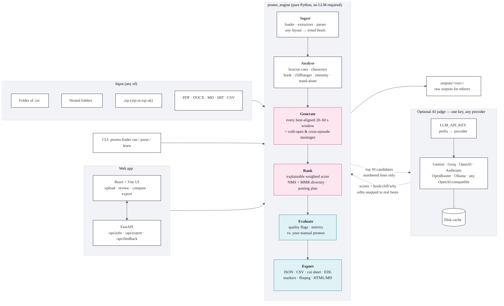
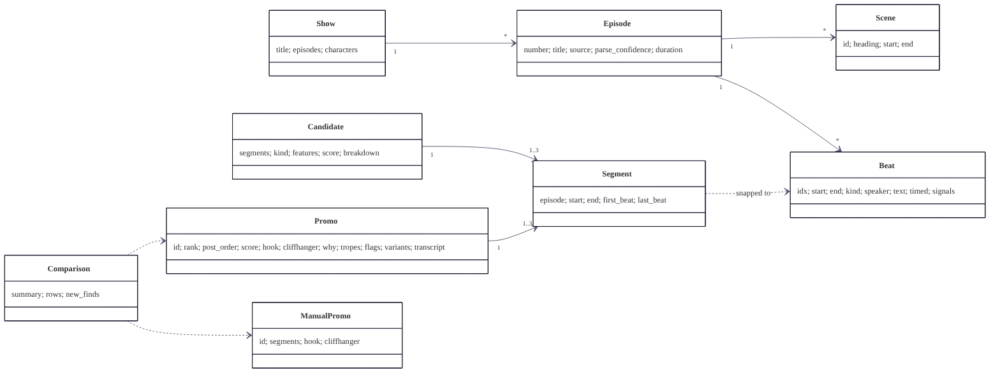
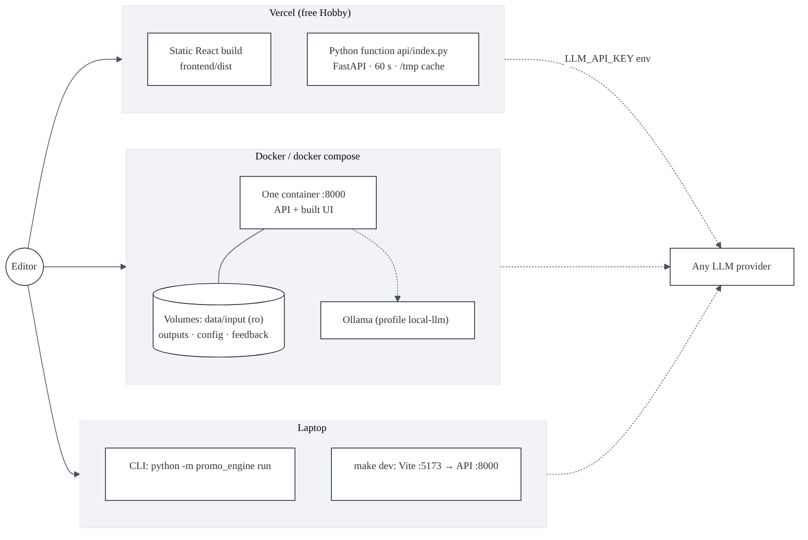

# Architecture

## Design principles

1. **Rules for recall, the LLM for taste.** Exhaustive, deterministic, free code finds and scores every possible clip. An optional LLM judges only the shortlist. The tool is useful with no key and better with one.
2. **Never invent a timestamp.** Every cut point is a real beat boundary from the screenplay. The LLM sees numbered lines and answers in line numbers, which are validated and snapped back to beats.
3. **Explain everything.** Each promo carries its score breakdown, hook and cliffhanger type, context risks and warning flags. Editors can disagree with a specific reason, not with a black box.
4. **One key, any model.** The provider comes from the key's prefix and the model from the provider's `/models` list. Three HTTP shapes (OpenAI-compatible, Anthropic, Gemini) cover every vendor without SDKs.
5. **Config over code.** Weights, thresholds and cue lexicons are YAML. The learner writes `learned_weights.yaml`.

## Packages

| Package | Files | Responsibility |
|---|---|---|
| `promo_engine.ingest` | `loader.py`, `extractors.py`, `parser.py` | Files/folders/zips → `SourceDoc` → `Show(Episodes(Beats))` |
| `promo_engine.analysis` | `lexicon.py`, `features.py`, `characters.py`, `standalone.py` | Per-beat signals, character registry, stand-alone penalties, intensity curve |
| `promo_engine.generate` | `candidates.py`, `boundaries.py`, `montage.py` | Window enumeration + features, start refinement and variants, multi-segment promos |
| `promo_engine.rank` | `scorer.py`, `diversity.py`, `schedule.py`, `explain.py`, `learner.py` | Weighted score, NMS + MMR + caps, posting order, text, weight learning |
| `promo_engine.llm` | `base.py`, `providers.py`, `prompts.py`, `judge.py`, `cache.py` | Provider detection, HTTP clients, prompts, guarded re-ranking, cache |
| `promo_engine.evaluate` | `manual.py`, `compare.py`, `quality.py`, `metrics.py` | Manual promo loading, IoU matching + diagnosis, flags, run metrics |
| `promo_engine.export` | `exporters.py`, `editor_formats.py`, `report_html.py` | JSON/CSV/MD, cut sheet, EDL, markers, ffmpeg, HTML |
| `promo_engine` | `models.py`, `timecode.py`, `config.py`, `pipeline.py`, `cli.py` | Data model, timecodes, config, orchestration, CLI |
| `backend` | `app.py`, `schemas.py`, `storage.py` | FastAPI: jobs with progress, stateless exports, feedback, sandboxed server-path input |
| `api` | `index.py` | Vercel entry |
| `frontend` | `src/…` | React UI |

## Data model

- **Beat**: one line, action, SFX or scene heading, with `start`, `end`, `kind`, `speaker`, `text`, `timed` (explicit or interpolated) and `signals` (hook, cliff, resolution, intensity, context, tropes…).
- **Candidate**: one or more **Segments** (episode, start, end, first/last beat) plus window features and the score breakdown.
- **Promo**: a selected candidate plus rank, post order, hook, cliffhanger, why, tropes, flags, variants and transcript.

## Deployment topologies

| Mode | Process | Storage | Limits |
|---|---|---|---|
| CLI | `python -m promo_engine run` | `outputs/` | none |
| Local web | `uvicorn backend.app:app` (+ Vite in dev) | `outputs/runs/`, `data/feedback/` | none |
| Docker | one container: API + built UI | mounted volumes | none |
| Vercel | static UI + Python function | `/tmp` only, stateless exports | 4 MB upload, 60 s |

## Security and confidentiality

- The input pack is git-ignored and excluded from the Docker image and the Vercel bundle.
- Server-folder input is restricted to `INPUT_ROOT` (default `data/`) and disabled on Vercel. Path traversal returns 403 (tested).
- Zips are read in memory (no zip-slip) with a 300 MB uncompressed budget (zip-bomb guard).
- LLM keys pasted in the UI are used for one request, never stored, and masked in every response (tested).
