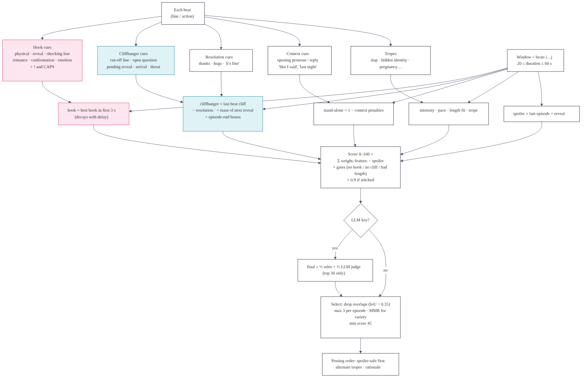

# How a promo is scored



## 1. Beat signals (one per line or action)

Each beat is matched against cue groups in `config/lexicons.yaml`. Groups combine as a noisy-OR, `1 − Π(1 − wᵢ)`, so several weak cues add up but the result never exceeds 1.

| Signal | Cue groups (weight) | Extras |
|---|---|---|
| **hook** | physical 0.95 (slap, shove, throws a drink, grabs by the throat), reveal 0.9 (heir, pregnant, DNA, "the real…", evidence falls out), shocking line 0.8 ("how dare you", "you're nothing but a maid", divorce, liar), romance 0.7, confrontation 0.6, emotional peak 0.45 | dialogue: `!` (+12% each, max 2), ALL CAPS share (+25%), short punchy line (+10%) |
| **cliff** | explicit marker 0.95 (SMASH CUT, TO BE CONTINUED), interrupted 0.85 (`—`, `...`), reveal pending 0.85 ("turns around", "eyes widen", "who are you"), arrival 0.75 (door bursts open, phone rings), open question 0.7, threat 0.7, decision pending 0.6 | an open question that is also a resolution counts × 0.6 |
| **resolution** | thanks/goodbye, hugs, "it's fine", "okay." | lowers the cliff score at the cut |
| **context** | opening pronoun 0.55, opening reply 0.45, back-reference 0.5 ("like I said", "last night") | used by the stand-alone check |
| **tropes** | slap/humiliation, hidden identity, rich/powerful, betrayal, pregnancy, marriage/contract, revenge, family rejection, supernatural, danger | each trope has a "sells" value 0.7–1.0 |
| **intensity** | 0.75·hook + `!` + CAPS + trope presence | drives the heatmap |

Analysis notes: wrapping quotes are stripped before matching (the real pack quotes every line), delivery notes in parentheses (e.g. "Cold, Commanding") can only add emotional or confrontation evidence (×0.5), never a physical event, `CAMERA` beats count 0.6× for hooks and non-explicit cliffhangers, and titles on their own ("the Duchess") are a weak *status mention* (0.3), not a reveal.

## 2. Window features (one per candidate)

A window is beats *i…j* with `20 s ≤ end(j) − start(i) ≤ 60 s`. It never starts on a scene heading and never ends on one.

| Feature | Formula |
|---|---|
| hook | max over beats starting ≤ 3 s after IN of `hook × (1 − 0.08·delay)` |
| cliffhanger | `cliff(last)`, or `0.8·cliff(previous)` if the last beat is a < 1.5 s reaction; `× (1 − 0.7·resolution)`; tease: if the next beat in the same scene is a reveal ≥ 0.6, `1 − (1 − c)(1 − 0.45·reveal)`; episode end: `1 − (1 − c)·0.7` |
| standalone | `1 − penalties` (opening pronoun or reply −0.15, back-references −0.08 each up to −0.25, answer to an off-clip question −0.12, off-screen names −0.06 each, > 4 speakers −0.1, > 2 scenes −0.05 each) + 0.08 for a clean scene entry |
| intensity | `0.6·mean(top half) + 0.4·peak` |
| pace | content beats per 10 s ÷ 4, capped at 1; × 0.7 if any gap > 6 s |
| duration_fit | `exp(−((dur − target)/15)²)`, target 35 s (platform presets change it) |
| trope | `max(trope_value × min(1, count/2))` |
| episode_end | 1 if the cut is the episode's last beat |
| spoiler | `max(0, (episode_fraction − 0.4)/0.6) × (0.5 + 0.5·max reveal)` |

## 3. Score

```
score = 100 × ( Σ wₖ·featureₖ − w_spoiler·spoiler ) / Σ wₖ
        × 0.85 if hook < 0.15      × 0.85 if cliffhanger < 0.15
        × 0.70 if length is out of range
        × 0.90 if stitched (montage)
```

Default weights: hook 0.30 · cliffhanger 0.25 · standalone 0.15 · intensity 0.12 · pace 0.05 · duration_fit 0.05 · trope 0.05 · episode_end 0.03 · spoiler 0.08. Every promo shows its contribution per feature ("Score breakdown").

## 4. Refinement, variants, montages

- **Refine:** if the hook beat is not the first beat, the lead-in is trimmed when the clip stays ≥ 20 s and the score does not drop, so the hook lands at 0.0 s.
- **Variants:** *tight* is the shortest clip ending on the same cliffhanger. *Long* is the longest clip (≤ 60 s) that preferably starts at a scene start.
- **Cold-open montage:** the episode's strongest hook moment (2.5–8 s) as a flash-forward, followed by the build-up that cuts within 4 s before that moment.
- **Escalation supercut:** 2–3 hook-led moments (6–20 s each) from episodes ≤ 6 apart that share a main character, in story order, where the last one ends on a cliffhanger ≥ 0.4.

## 5. Selection and posting

- Pool → score ≥ `min_score` (45) → greedy MMR: `0.78·score/max − 0.22·similarity`, where similarity = 0.5 for the same episode + 0.3 × trope Jaccard + 0.2 for the same hook type. Overlaps with IoU > 0.35 (or > 60% of the shorter clip) are dropped, with at most 3 per episode and 3 montages.
- **Posting order:** priority = score + 1.5·spoiler_penalty (negative) + 4 if from episodes 1–3 − 6 if outside the first 40% of episodes. Consecutive posts swap in the next candidate (within 6 points) when they would repeat the trope or episode. Each slot gets a written reason.

## 6. LLM judge (optional)

- The top 30 by heuristic score go to the LLM, 5 per call. The prompt shows 2 context lines before the clip, the clip as numbered lines with times, and the line after the cut.
- The model returns 0–10 scores for hook, cliffhanger, stand-alone and overall, short texts, red flags, and optional `start_line` / `end_line`.
- Edits are accepted only for single-segment promos, only to lines inside the clip, and only if the result stays within the length window. Rejections are counted in the report.
- `final = 0.5 × heuristic + 0.5 × (overall × 10)`. A strong disagreement (> 30 points) raises the `llm_disagrees` flag.

## 7. Learning from editors

`promo-finder learn` builds positives from pool windows that match your manual promos (IoU ≥ 0.3) plus your promos' own windows, and negatives from the highest-scoring non-matches (hard negatives) plus random ones. It fits an L2 logistic regression, maps the coefficients to non-negative weights, blends them 50/50 with the defaults, and writes `config/learned_weights.yaml`.
