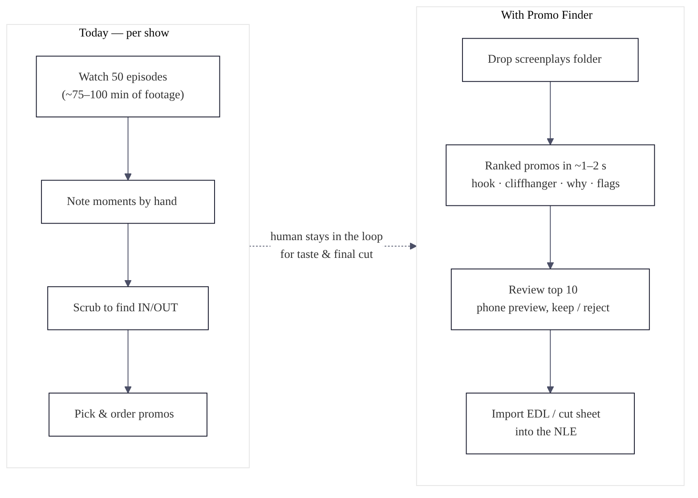
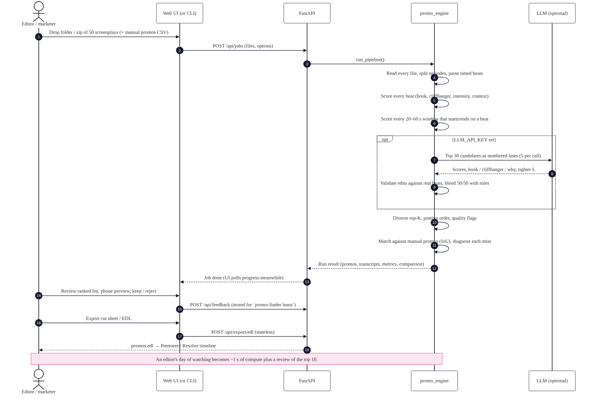

# Workflow

## For the editor

| Today (per show) | With Promo Finder |
|---|---|
| Watch ~50 episodes (75–100 min of footage) | Drop the screenplay folder (seconds) |
| Note candidate moments by hand | Ranked promos with hook, cliffhanger and why (~1–2 s rules, < 1 min with LLM) |
| Scrub each episode for IN/OUT | Exact IN/OUT per segment, beat-aligned, with handles |
| Decide what to post first | Posting plan with reasons |
| — | Review the top 10 in the phone preview, keep or reject (feedback trains the ranking) |
| Rebuild the selects in the NLE | Import the EDL: every promo is on one timeline |

A human stays in the loop for taste and the final cut. The tool removes the watching and scrubbing.

## Request flow (web app)

1. The UI posts files (plus optional manual promos and options) to `POST /api/jobs`.
2. Locally or in Docker, the job runs in a background thread and the UI polls `GET /api/jobs/{id}` for stage and progress. On Vercel the job completes inside the request.
3. The result JSON (promos, transcripts, heatmap, metrics, comparison) is kept by the browser. It also lives in `outputs/runs/<id>/` when not serverless.
4. Exports are **stateless**: the browser posts the run to `POST /api/export/{fmt}` and gets a file back. This works on serverless too.
5. Keep/reject clicks go to `POST /api/feedback` and are appended to `data/feedback/feedback.jsonl`. `promo-finder learn` uses them.

## Pipeline stages and timings (50-episode synthetic show, rules only)

| Stage | What | Typical time |
|---|---|---|
| ingest | read files, unzip, extract text | < 0.1 s |
| parse | episodes → timed beats, characters | ~0.1 s |
| signals | per-beat cue scoring | ~0.1 s |
| candidates | all beat-aligned 20–60 s windows, features, per-episode NMS | ~0.8 s |
| montages | cold opens + cross-episode supercuts | ~0.1 s |
| llm (optional) | 6 calls × 5 candidates | 5–30 s depending on provider |
| rank | MMR selection, texts, variants, flags, posting plan | < 0.1 s |
| compare | IoU matching + re-scoring editor windows | < 0.1 s |

See `METRICS.md §7` for measured numbers.

## API endpoints

| Method | Path | Purpose |
|---|---|---|
| GET | `/api/health` | Version, limits, detected LLM (masked) |
| GET | `/api/options` | Defaults, platform presets, weights |
| POST | `/api/llm/check` | Detect the provider from a key (optional test call) |
| POST | `/api/jobs` | Upload files (+manual) → job with progress |
| GET | `/api/jobs/{id}` | Job status / result |
| POST | `/api/analyze` | Synchronous upload + run |
| POST | `/api/analyze/sample` | Run the bundled sample show |
| POST | `/api/analyze/path` | Run a server folder inside `INPUT_ROOT` (local/Docker) |
| GET | `/api/runs`, `/api/runs/{id}` | Recent runs |
| GET | `/api/runs/{id}/export/{fmt}` | Export a stored run |
| POST | `/api/export/{fmt}` | Stateless export (`json csv cutsheet md html edl markers ffmpeg comparison`) |
| POST/GET | `/api/feedback` | Store / list keep-reject feedback |
| GET | `/api/template/manual` | Manual promos CSV template |

Interactive docs: `/docs` (Swagger) when the server is running.
